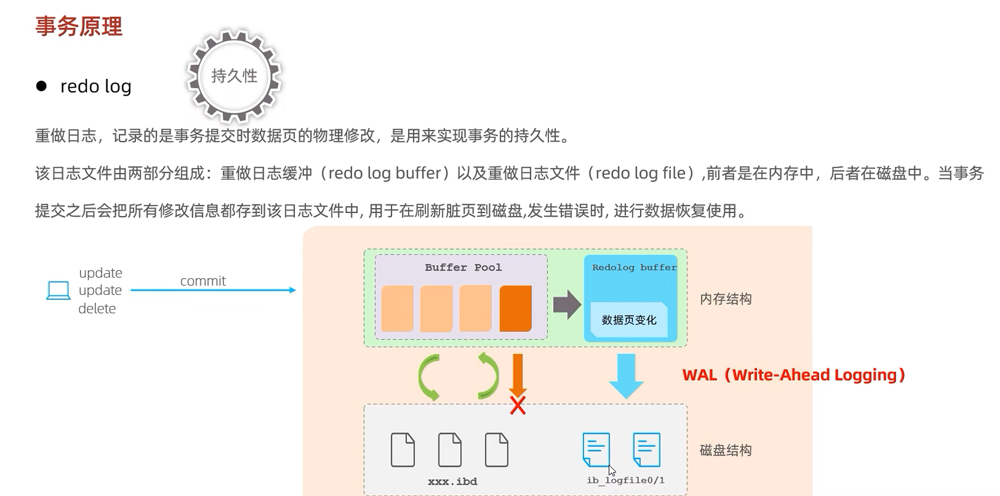

数据库三大范式   1.任何字段都要拆分到不可拆分位置，比如 毕业信息 xx大学，27届要拆分成 毕业学校：xx大学  毕业时间：2027   2.所有非主属性要依赖主属性，不能部分依赖。比如订单号，商品号是一条数据（订单号，商品号是联合主键），还有订单金额这个字段。订单金额只依赖订单号，不依赖商品号。要拆分出去。   3.非主属性要和主键直接相关，不能部分相关。非主属性不依赖其他非主属性。比如 学生信息，班主任名字，班主任性别，班主任年龄。班主任性别和年龄是间接依赖主书信，直接依赖非主属性班主任名字。要拆分一个表，班主任名字，班主任性别，班主任年龄。  

索引：
优点：提高查询效率、通过索引进行排序
缺点：需要额外占用空间，需要维护索引的b+树导致插入、删除、更新的效率降低。  

索引分类：
主键索引               针对表中主键创建的索引        默认自动创建，只能有一个     PRIMARY
唯一索引                避免同一列的值重复                        可以有多个      UNIQUE
常规索引（普通索引）    快速定位特定数据                           可以有多个
全文索引               查找文本中的关键词，而不是比较索引中的值。   可以有多个。  FULLTEXT

根据索引的存储形式索引又分成两种：
聚簇索引（聚集索引）： 将数据与索引放在一块，索引的叶子结点保存了行数据。   必须有，且唯一。
非聚簇索引（二级索引、辅助索引）： 将数据与索引分开存储，索引的叶子结点关联的是对应的主键id 。   可以存在多个。

聚簇索引的选取规则：
1.默认是主键
2.没有主键，选取第一个唯一索引
3.没有主键和唯一索引，自动生成一个隐藏的rowid作为聚簇索引

常规索引检索举例：select * from table where name ="zhangsan";
id   name        age
1    zhangsan    20 
2    zhangsan    21
3    lisi        25

先通过二级索引name,拿到两个主键id  ->(zhangsan,1),(zhangsan,2)
再通过(1，2)检索出
1    zhangsan    20     
2    zhangsan    21

 

索引语法：
创建索引：
CREATE [UNIQUE|FULLTEXT] index_name ON table_name (index_col_name,...) //单字段就是单列索引，双字段就是联合索引

查看索引：
SHOW INDEX FROM table_name;

删除索引:
DROP INDEX index_name ON table_name;

查询数据库的执行频次
show global status like 'Com_______'
Com_select  //查询次数

Com_insert  //插入次数

Com_update  //更新次数

Com_delete  //删除次数

Com_commit

Com_rollback

慢查询日志

show variavles like 'slow_queue_log'; //查看慢查询日志开关是否开启

慢查询日志记录了所有执行时间超过指定参数(long_query_time,单位：秒，默认10秒)的所有sql语句的日志。

Mysql的慢查询日志默认没有开启，需要再mysql的配置文件中配置：
#开启Mysql慢查询日志开关
slow_query_log = 1

#设置慢日志时间为2s，执行时间超过两秒就会被视为慢查询。(不是只记录SELECT，INSERT、UPDATE超过时间阈值也会记录)
long_query_time = 2

也可以直接命令开启
SET GLOBAL slow_query_log = 'ON';
SET GLOBAL long_query_time = 1;

profile//查询sql的具体执行时间

EXPLAIN执行计划
EXPLAIN/DESC命令获取MySQL如何执行SELECT语句的信息，包括在SELECT语句执行过程中表如何连接和连接的顺序。
语法：
#直接在SELECT语句前加EXPLAIN或DESC
EXPLAIN + SELECT语句

select_type:表示select的类型，常见有：SIMPLE（简单表，不用表连接或子查询）、PRIMARY（主查寻，即外层的查询）、UNION、SUBQUERY（包含了子查询）
type：表示连接类型，性能由好到坏的连接类型为：NULL、system、const、eq_ref、ref、range、index、all
possible_key:显示可能应用的索引、一个或多个
key：实际走的是哪个索引
rows:扫描行数

主要看type和key

联合索引的失效场景

最左前缀法则：
1.针对联合索引，查询从索引的最左列开始，没有最左边的列，索引就会失效。
有最左边的但是中间的断开了，索引将会部分失效，（断开的部分字段索引失效。）

(name,age,score) 索引 index_name_age_score

1.查询不带name,索引完全失效
select * from student where age ='10' and score ='89';

2.查询条件断开，索引部分失效
select * from student where name ='张三' and score ='100';

3.和顺序无关，只要有最左的，就会走索引。
select * from student where name ='张三' and score ='100' and name = '张三';

前缀索引：对文章或者是较长的文本的前面几个字符建立索引。
create index idx_text_5 on article(text(5)); //对这个字段的前5个字符建立索引

对要建立前缀索引的字段进行选择性计算:select count(distinct substring(text,1,6))/count(*) from article; 
选择性越高，前缀索引效果越好。

索引建立原则：
1.数据量比较大，100万条以上
2.针对常用与where条件的字段建立索引。
3.针对区分度比较大的字段建立索引，如身份证。区分度不大的不适合，如性别。
4.字符串类型字段建立索引，字段的长度较长，建议考虑前缀索引。
5.尽量使用联合索引，减少单列索引。很多时候，联合索引可以直接覆盖索引，节省存储空间，避免回表查询，提高查询效率。
6.控制索引的数量，索引越多，维护索引的代价也越大。
7.如果索引不能存储null，在创建表的时候用NOT NULL约束他。当优化器知道每列是否包含NULL时，它可以更好地确定哪个索引最有效地用于查询。

锁
全局锁：
全局锁就是对在整个数据库实例（1个Mysql服务，不止1个Mysql连接）加锁，加锁后整个实例就处于只读状态，后续的DML写语句，DDL语句，以及更新操作的事务提交语句都会被阻塞。
典型的应用场景就是做全库的逻辑备份，对所有的表进行锁定，从何获取一致性视图，保证数据的完整性。

flush tables with read lock;//加锁
unlock tables;              //解锁

表级锁：
每次操作锁住整张表。锁定粒度大，发生锁冲突的概率最高，并发度最低。
表级锁主要分三类：
1.表锁
分两类：
1.1表共享读锁（read lock） :只能读，不能写。其他客户端写数据库会阻塞
1.2表共享写锁（write lock）：当前客户端可以读，也可以写。其他客户端不能读，也不能写（会被阻塞）。
加锁： lock tables 表明... read/write  
释放锁：unlock tables / 客户端断开连接自动释放锁

读锁不会阻塞其他客户端的读，但是会阻塞写。写锁既会阻塞其他客户端的读，又会阻塞其他客户端的写。

2.元数据锁（meta data lock，MDL）
MDL加锁过是系统自动控制，无需显示使用，在访问一张表的时候会自动加上。MDL主要是维护表元数据的一致性。在表上有活动事务的时候，不可以对元数据进行写入操作。为了避免DML（操作数据）语句和DDL（操作表结构）语句的冲突，保证读写的正确性。
简单来说就是如果某一张表存在未提交的事务，那么我们不能去修改这张表的表结构。

3.意向锁
为了避免DML在执行时，加的行锁与表锁的冲突，在InnoDB中引入了意向锁，使得表锁不用检查每行数据是否加锁，使用意向锁来减少表锁的检查。

行级锁：
每次操作锁住对应的行数据。锁定粒度最小，发生锁冲突的概率最低，并发度最高。应用在InnoDB存储引擎中。
InnoDB的数据是基于索引组织的，行锁是通过对索引上的索引项加锁（聚簇索引叶子结点）来实现的，而不是对记录加的锁。对于行级锁，主要分为以下三类：
1.行锁：锁定单个记录的锁，防止其他事务对此进行update和delete。在RC、RR隔离级别下都支持。
共享锁：允许一个事务去读一行，阻止其他事务获得相同数据集的排它锁。
排它锁：允许获取排它锁的事务更新数据，阻止其他事务获得相同数据集的共享锁和排它锁。

默认情况下，InnoDB在 REPEATABLE READ事务隔离级别运行，InnoDB使用 next-key 锁进行搜索和索引扫描，以防止幻读。

针对唯一索引进行检索时，对已存在的记录进行等值匹配时，将会自动优化为行锁。

InnoDB的行锁是针对于索引加的锁，不通过索引条件检索数据，那么InnoDB将对表中的所有记录加锁，此时 就会升级为表锁。

2.间隙锁：锁定索引间隙（不含该记录），确保索引记录间隙不变，防止其他事务在这个间隙进行insert，尝试幻读。在RR隔离级别下都支持。
3.临键锁：行锁和间隙锁组合，同时锁住数据，并锁住数据前面的间隙Gap。在RR隔离级别下支持。

事务原理

mvcc
并发事务问题：
1.脏读：一个事务读取到另一个事务还没有提交的数据。
2.不可重复读：一个事务先后读取同一条记录，但两次读取的数据不同，称为不可重复读。
3.幻读：一个事务按照条件查询时，没有对应的数据行，但是在插入数据时，又发现这行数据已经存在了，好像出现了"幻影"。

事务隔离级别            脏读        不可重复读      幻读
Read uncommitted        √             √             √
Read committed          x             √             √ 
Repeated Read(默认)     x              x             √ 
Serializablw            x              x            x

MVCC实现的三个核心：
1.隐藏字段：
2.undo log
3.readview